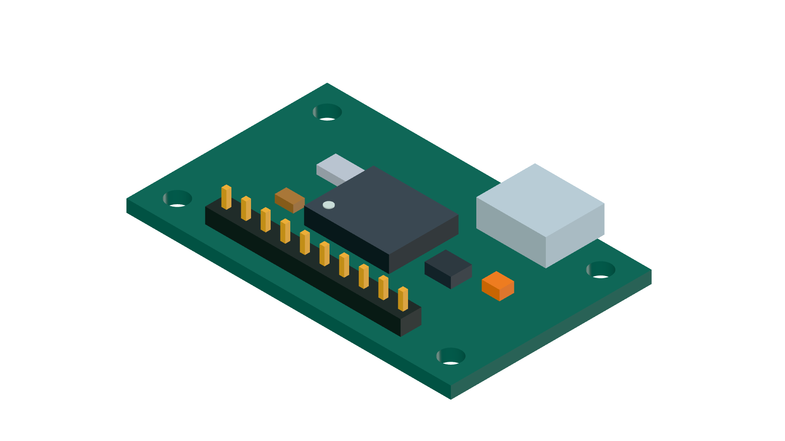

# OpenStepShot

在浏览器里打开 STEP 装配体，保留零件和面的颜色，调整视角后导出 PNG 或 JPG。适合制作产品图、装配说明和文档插图。

[打开在线工具](https://geekheart.github.io/OpenStepShot/) · [快速开始](#快速开始) · [示例 STEP](public/examples/sample-module.step) · [GitHub Pages](#github-pages)



## 快速开始

1. 点击「打开 STEP」或把 `.step`、`.stp` 文件拖到预览区。也可以点「试用示例」加载随站点提供的彩色装配体。
2. 选择预设视角，或按住左键拖动旋转，滚轮缩放，右键拖动平移。点击「适配」可在当前角度重新居中并完整显示模型。
3. 选择输出格式、尺寸和背景，再点「下载」。图片使用预览框内的构图，坐标轴和棋盘格只在页面里显示。

| 功能 | 说明 |
| --- | --- |
| 模型预览 | 支持 STEP 装配体，保留零件位置和 STEP 自带的面颜色，未着色零件使用默认颜色 |
| 正交视角 | 等轴测、俯视、仰视、前视、后视、左视、右视和自由旋转。以模型 Z 轴朝上，前视从 −Y 方向看向模型 |
| PNG | 支持透明、白色和深色背景 |
| JPG | 使用白色或深色背景，质量可调 |
| 尺寸 | 横向、竖向、方形、4K 和自定义宽高。单边上限由浏览器图形能力决定，最高为 4096 px |

需要支持 WebGL 2 和 WebAssembly 的现代浏览器。页面通过 Web Worker 读取本机选择的 STEP，渲染和导出也在浏览器完成。访问网站时，网络请求用于获取静态页面、解析器和可选的公开示例。

## 本地开发

在工具仓库根目录使用 Node.js 22.12 或更新版本运行以下命令。

```sh
npm ci
npm run dev -- --host 127.0.0.1
```

打开终端打印的地址。构建和检查发布产物时运行以下命令。

```sh
npm run build
npm run check:pages
npm run preview -- --host 127.0.0.1
```

## GitHub Pages

推送到 `main` 或推送 Git 标签，会检查构建并部署 GitHub Pages。Pull Request 只运行构建检查。也可以在 Actions 中从 `main` 或标签手动运行工作流。

在待发布提交上创建并推送标签，例如 `v1.1.0`。

```sh
git tag -a v1.1.0 -m "OpenStepShot v1.1.0"
git push origin v1.1.0
```

Fork 或新仓库需要在 **Settings → Pages → Build and deployment** 里将 **Source** 设为 **GitHub Actions**，并在 `github-pages` 环境的部署规则中允许 `main` 分支和标签。常规标签使用 `*` 规则，带斜杠的标签可添加 `**/*` 规则。发布地址和状态可在部署任务中查看。[GitHub 自定义 Pages 工作流](https://docs.github.com/pages/getting-started-with-github-pages/using-custom-workflows-with-github-pages)

构建使用相对资源路径。也可将 `dist/` 发布到其他静态托管服务，包括站点子目录。

## 代码结构

| 路径 | 用途 |
| --- | --- |
| [`src/`](src/) | 页面、文件与导出交互、Three.js 预览 |
| [`public/step-worker.js`](public/step-worker.js) | 在 Worker 中运行 OCCT.js，解析 STEP 几何和颜色 |
| [`public/examples/`](public/examples/) | 用于试用和核验的合成模型 |
| [`.github/workflows/pages.yml`](.github/workflows/pages.yml) | 构建检查与 GitHub Pages 发布 |

操作流程参考 [OpenPinMap](https://github.com/geekheart/OpenPinMap)。模型解析使用 [OCCT.js](https://github.com/tx-code/occt-js)，渲染使用 [Three.js](https://threejs.org/)。
